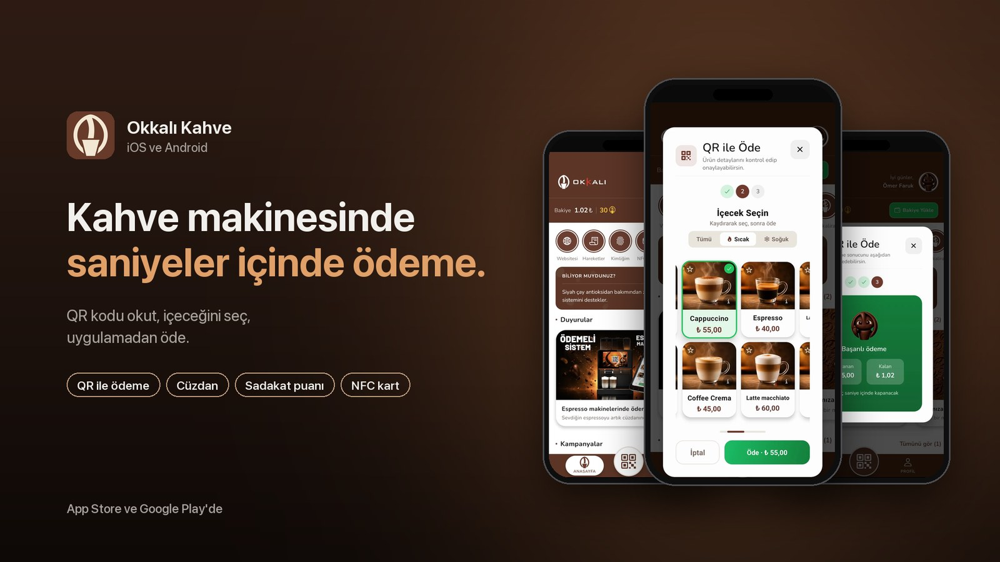
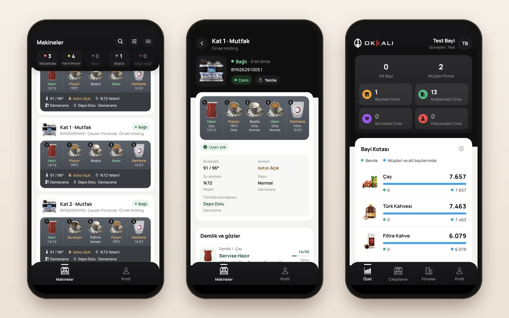
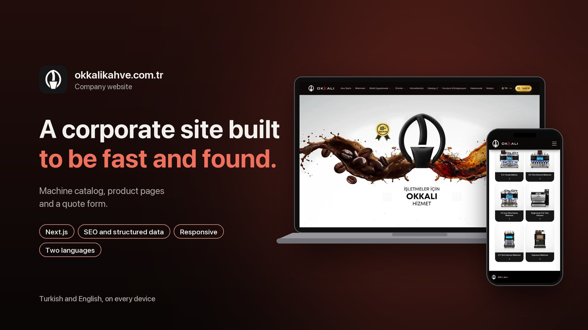

  

Software engineer at Okkalı Kahve in Istanbul. I build the apps, websites and tools behind IoT coffee and tea machines, from the phone in your hand to the hardware on the factory floor.

[omerfarukaydin.vercel.app](https://omerfarukaydin.vercel.app) · [LinkedIn](https://www.linkedin.com/in/omerayd%C4%B1n/) · [okkalikahve.com.tr](https://okkalikahve.com.tr)

## Work

<table>
  <tr>
    <td width="33%" valign="top">
      
      
<b>Okkalı Kahve App</b> 
      The app people use to pay at the machines: QR payment, an in-app wallet, loyalty points, NFC cards and drink stats. 
      React Native · Expo · TypeScript 
      <a href="https://apps.apple.com/tr/app/okkal%C4%B1-kahve/id6760692481">App Store</a> · <a href="https://play.google.com/store/apps/details?id=com.bayineriot.okkalikahve">Google Play</a>

    </td>
    <td width="33%" valign="top">
      
      
<b>Okkalı Kahve Kurumsal</b> 
      The app for the companies, dealers and machine attendants who run the machines: live machine status, consumption and quotas. 
      React Native · Expo · TypeScript 
      <a href="https://apps.apple.com/tr/app/okkal%C4%B1-kahve-kurumsal/id6755045436">App Store</a> · <a href="https://play.google.com/store/apps/details?id=com.bayineriot.okkalikahvekurumsal">Google Play</a>

    </td>
    <td width="33%" valign="top">
      
      
<b>okkalikahve.com.tr</b> 
      The company's website in Turkish and English, with a machine catalog, product pages and a quote form. 
      Next.js · TypeScript · Tailwind CSS 
      <a href="https://okkalikahve.com.tr">Visit the site</a>

    </td>
  </tr>
</table>

## Open source

- [**react-native-nfc-manager**](https://github.com/revtel/react-native-nfc-manager/pull/858): `getNfcAntennaInfo()`, the NFC antenna position on Android 14+, so an app can show where to hold the card. Shipped in v4.1.0
- **react-native-bluetooth-classic**: Android 14 receiver flags ([#372](https://github.com/kenjdavidson/react-native-bluetooth-classic/pull/372)), and `pairDevice` rejecting when pairing fails ([#374](https://github.com/kenjdavidson/react-native-bluetooth-classic/pull/374)). Open PRs
- [**expo-camera**](https://github.com/expo/expo/pull/52743): an `external` camera type, so an app can open a USB camera on Android. Open PR

## Side projects

- [**PolicyGPT**](https://github.com/omeraydin00/PolicyGPT): turns long government documents into step-by-step answers. Python, LangChain, Ollama
- [**VoiceGPT**](https://github.com/omeraydin00/VoiceGPT): a Turkish voice assistant that answers out loud. Whisper, Llama 3, Gradio
- [**Customer Support Agent**](https://github.com/omeraydin00/customer-support-agent): sorts customer messages and drafts replies. Python, Ollama, Streamlit
- [**Ollama-Agent-Kit**](https://github.com/EmreMutlu99/Ollama-Agent-Kit): an agent with memory and tool calling, from my internship at Sagel AI. Node.js, Ollama
- [**Farmer Market**](https://github.com/omeraydin00/farmer_market): a marketplace app for farmers and customers. Flutter, Firebase
- [**Riot Quiz**](https://github.com/omeraydin00/riotappv2): a League of Legends quiz game. Flutter
- [**Gym Management and Booking System**](https://github.com/omeraydin00/web-programlama-proje): branches, trainers and bookings. ASP.NET Core, PostgreSQL
- [**Cat Hospital**](https://github.com/omeraydin00/DatabaseManagmentSystems-Kedi_Hastanesi): a clinic system on a full PostgreSQL schema. Node.js, PostgreSQL

## Tools

TypeScript, JavaScript, Python, Kotlin, Dart, C# · React Native, Expo, Next.js, React, Node.js, Flutter · PostgreSQL, Firebase · Arduino, ESP32, NFC, USB serial

B.Sc. Computer Engineering, Sakarya University

  

